# Aula de Sistemas AWS

Plataforma educativa para practicar competencias técnicas, resolver incidencias y realizar evaluaciones mediante laboratorios guiados.

**Proyecto académico de arquitectura cloud con Amazon Web Services (AWS).**

[Ver aplicación](https://aula-de-sistemas-aws.pages.dev/)

> **Nota:** El frontend está publicado en Cloudflare Pages. El backend utiliza recursos de AWS Academy Learner Lab, por lo que las operaciones que necesitan la API dependen de que el laboratorio esté activo.

---

## 1. Objetivo del proyecto

El objetivo principal es desarrollar una plataforma que permita practicar y evaluar conocimientos técnicos relacionados con sistemas, redes, servicios cloud y seguridad.

El proyecto también sirve como práctica de diseño, despliegue e integración de una arquitectura basada en servicios de AWS.

## 2. Arquitectura cloud

La aplicación utiliza una arquitectura desacoplada: el frontend se publica de forma independiente y se comunica con un backend serverless mediante una API HTTP.

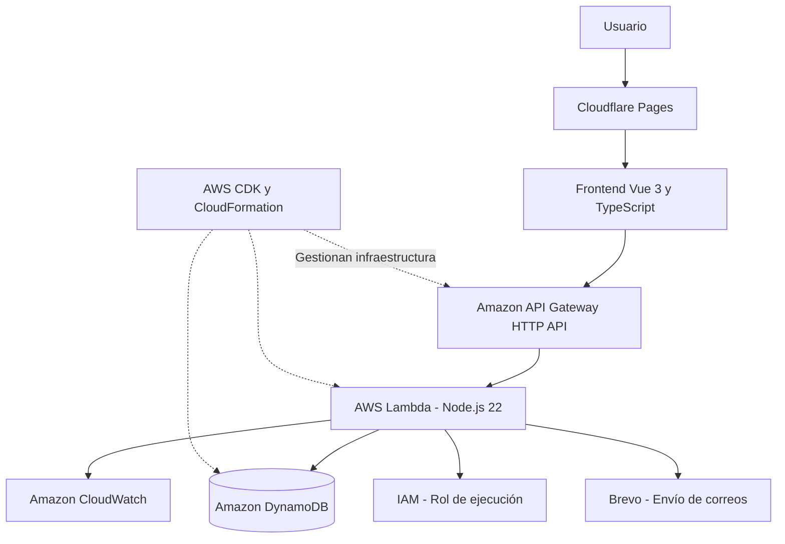

### Servicios y tecnologías utilizados

| Tecnología | Función en el proyecto |
|---|---|
| AWS Lambda | Ejecución de la lógica del backend sin administrar servidores. |
| Amazon API Gateway | Exposición de los endpoints HTTP de la aplicación. |
| Amazon DynamoDB | Almacenamiento de usuarios, evaluaciones, preguntas y resultados. |
| AWS IAM | Gestión de roles y permisos de ejecución. |
| Amazon CloudWatch | Registros y supervisión de las ejecuciones. |
| AWS CloudFormation | Gestión de los recursos de infraestructura. |
| AWS CDK | Definición de infraestructura mediante código. |
| Cloudflare Pages | Publicación del frontend. |
| Brevo | Envío de correos de verificación de cuentas. |

### Evidencias de infraestructura AWS

#### AWS Lambda

Funciones serverless encargadas de ejecutar las operaciones del backend.

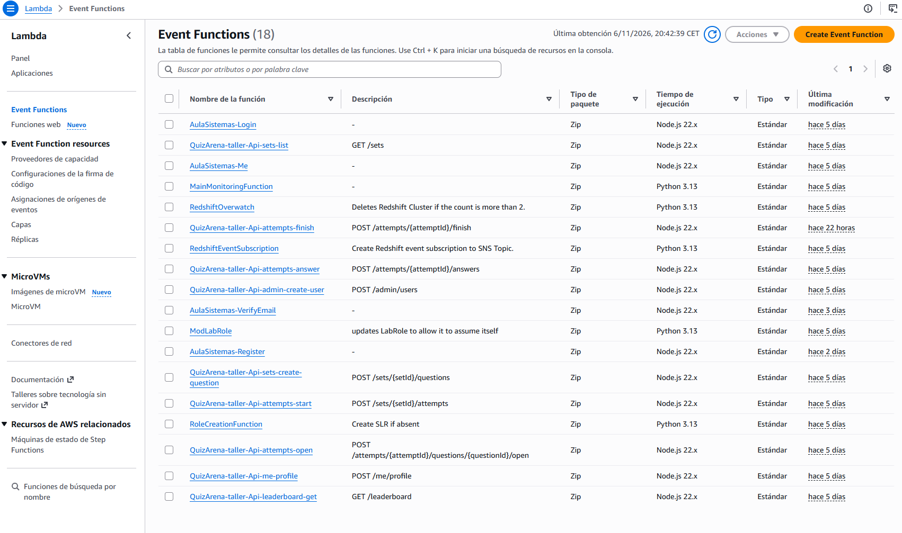

#### Amazon API Gateway

API HTTP que conecta el frontend con las funciones Lambda.

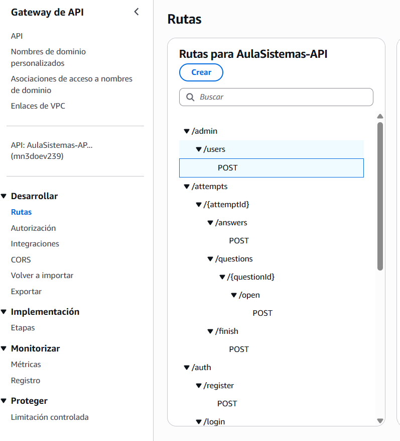

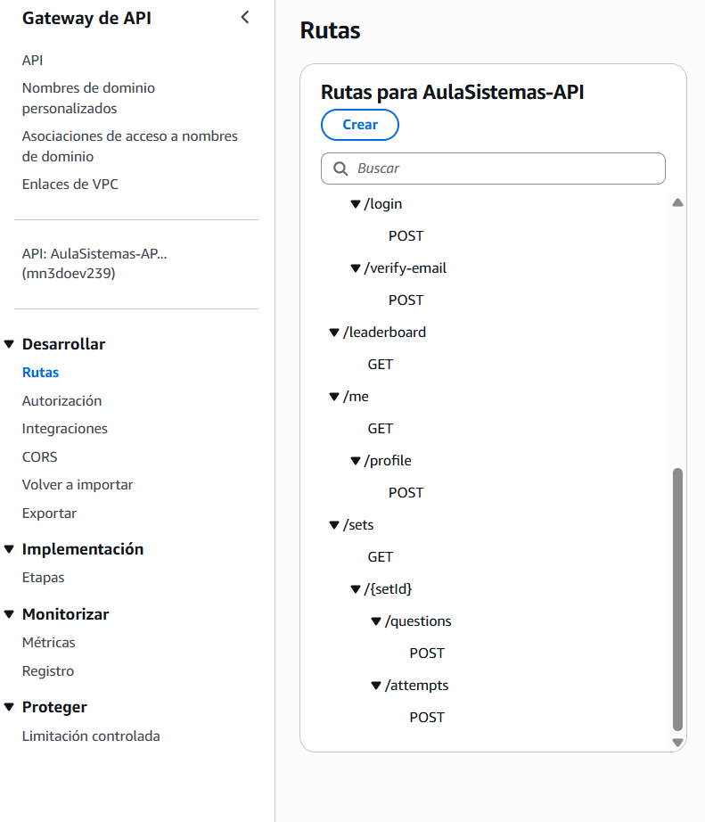

#### Amazon DynamoDB

Tabla utilizada para almacenar la información de la plataforma.

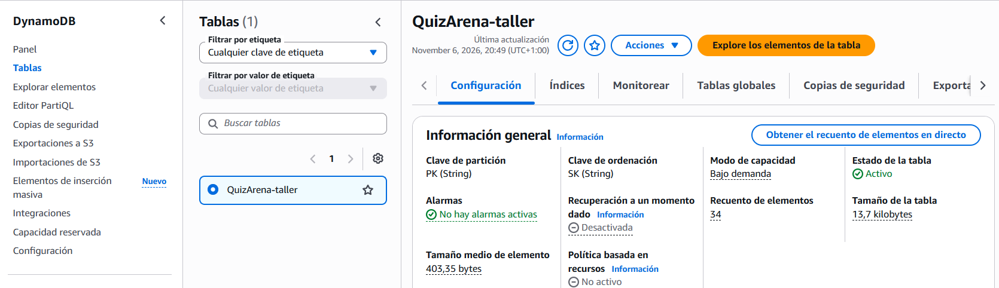

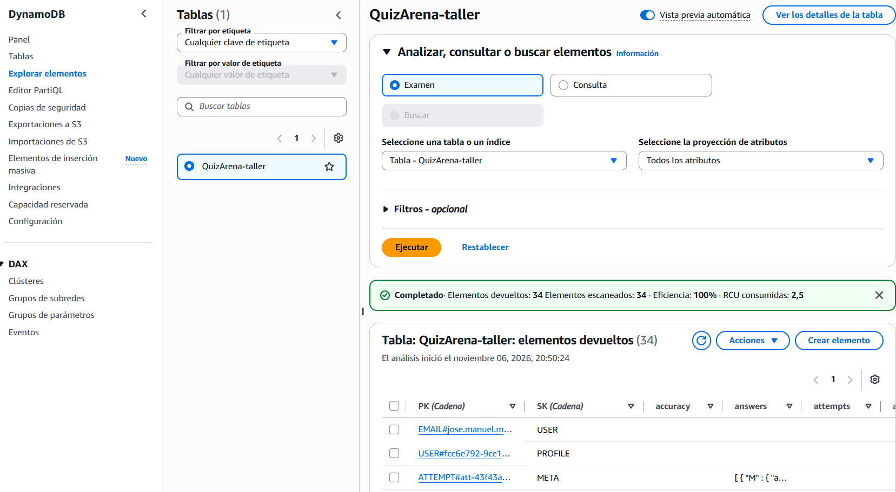

#### Amazon CloudWatch

Supervisión de las ejecuciones y consulta de los registros generados por Lambda.

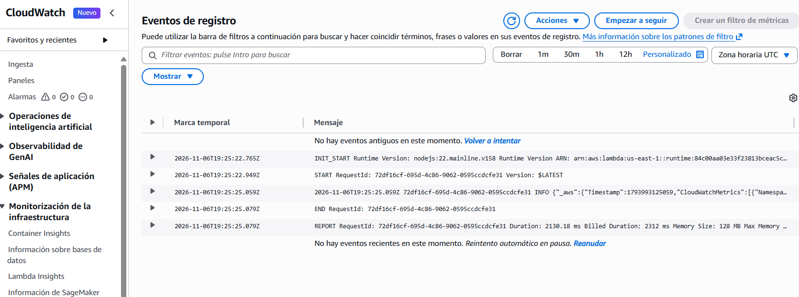

#### AWS IAM

Roles y políticas de permisos utilizados por los servicios.

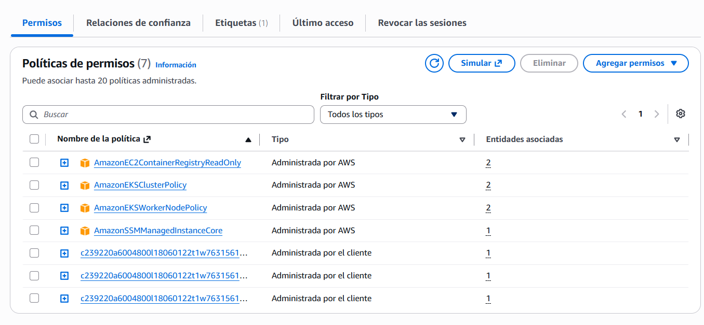

#### AWS CloudFormation

Seguimiento de los recursos y eventos de las pilas de infraestructura.

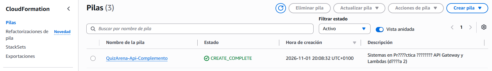

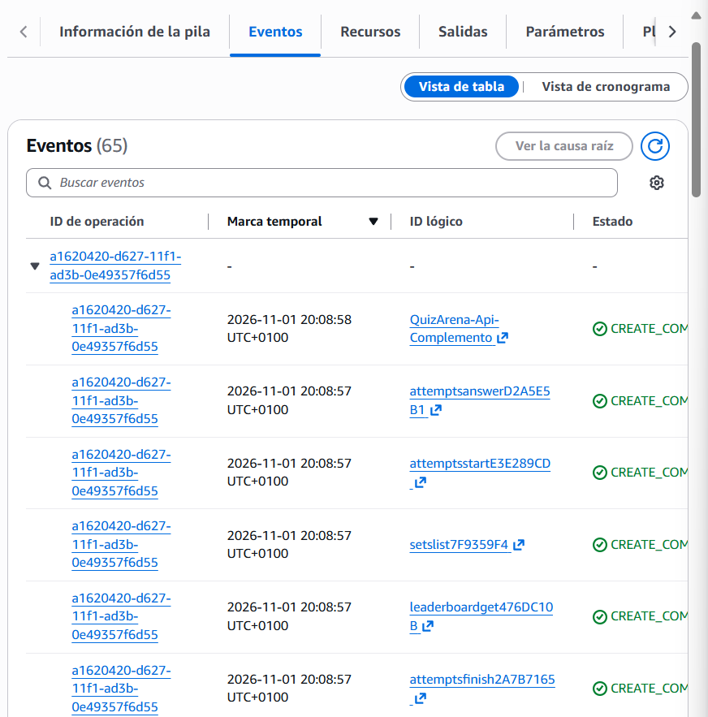

---

## 3. Funcionalidades de la plataforma

La plataforma permite trabajar con diferentes áreas de conocimiento y practicar mediante evaluaciones y escenarios simulados.

### Competencias

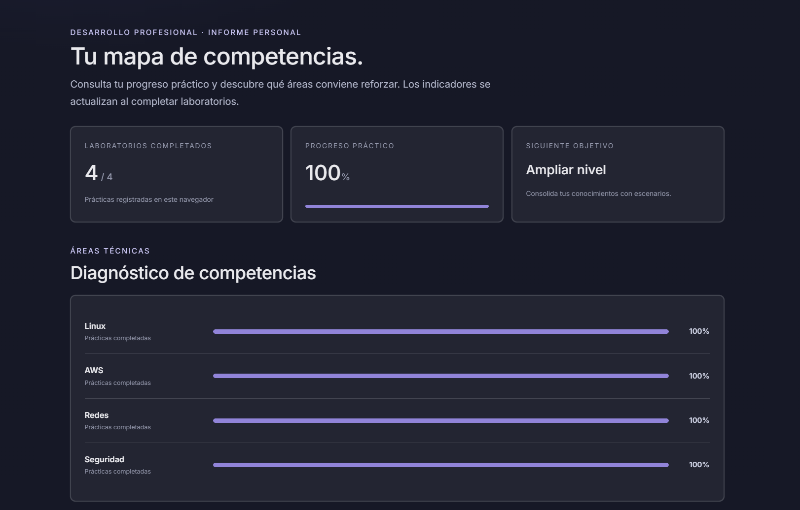

### Incidencias

Catálogo de situaciones técnicas inspiradas en problemas que pueden aparecer en entornos reales.

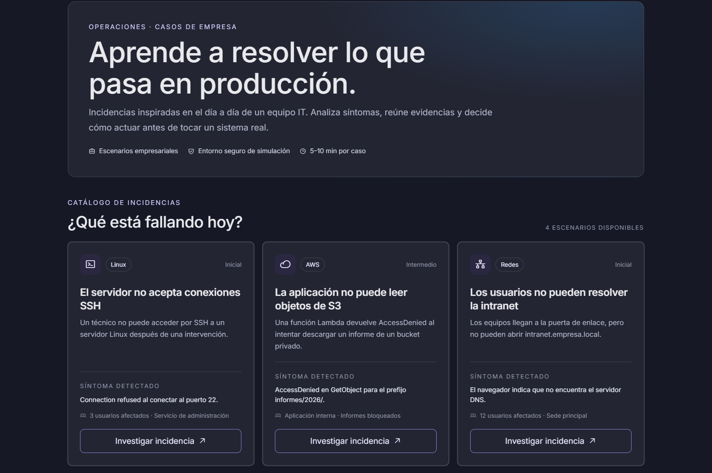

### Inicio de sesión

Sistema de registro, autenticación y verificación de correo electrónico.

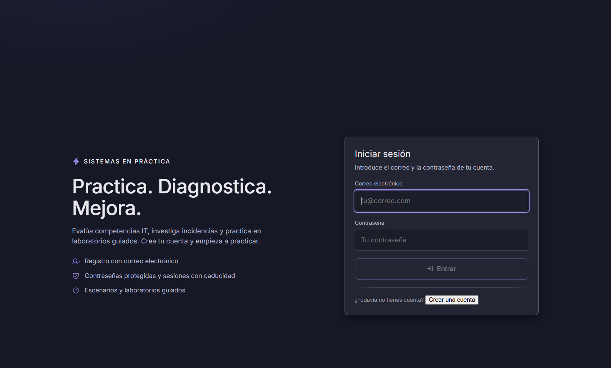

### Laboratorios guiados

Entornos de simulación donde se investigan incidencias paso a paso, interpretando comandos y resultados.

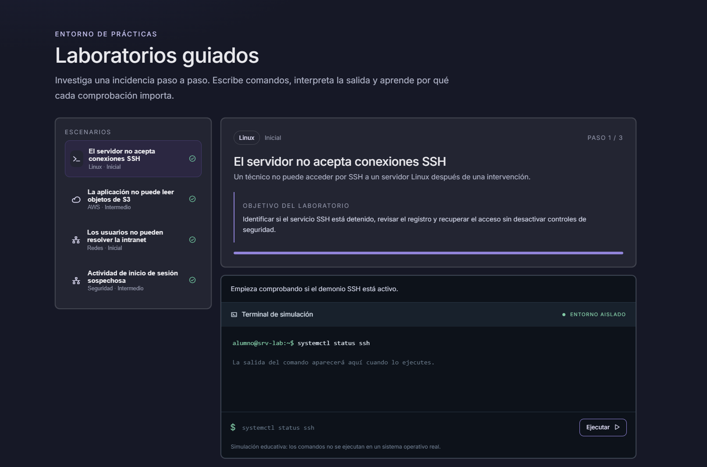

### Clasificación (Leaderboard)

Leaderboard con los resultados y puntuaciones de los participantes.

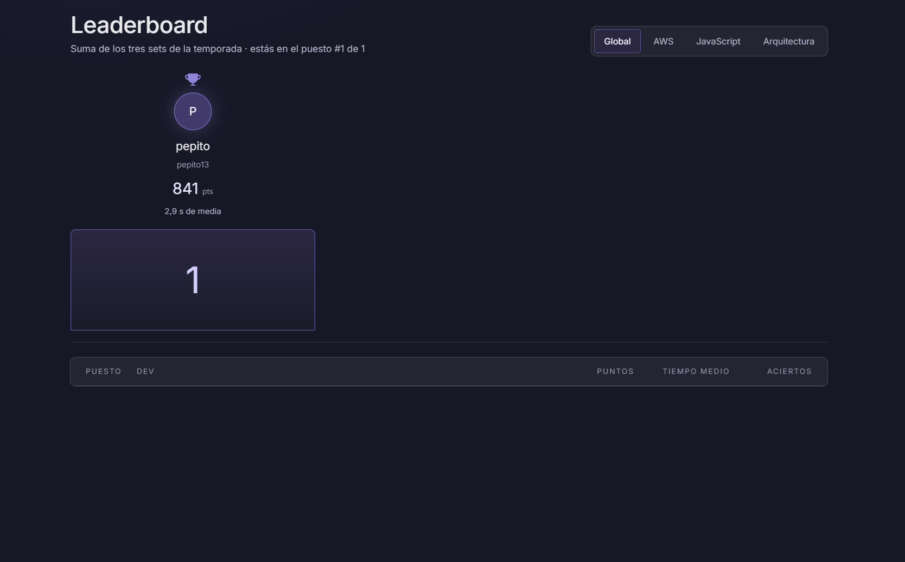

### Sets de evaluación

Conjuntos de preguntas para comprobar los conocimientos adquiridos.

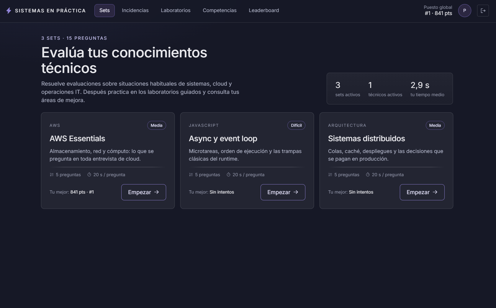

---

## 4. Escenarios prácticos

El proyecto incorpora cuatro escenarios de laboratorio:

1. **Linux:** servidor SSH que rechaza conexiones.
2. **AWS:** función Lambda sin permisos para leer objetos de S3.
3. **Redes:** problemas de resolución DNS en una intranet.
4. **Seguridad:** actividad de inicio de sesión sospechosa.

Los laboratorios utilizan una terminal simulada con fines educativos. Los comandos no se ejecutan sobre sistemas reales.

---

## 5. Tecnologías de desarrollo

- Vue 3
- TypeScript
- Vite
- Node.js 22
- AWS Lambda
- Amazon API Gateway
- Amazon DynamoDB
- AWS CDK y CloudFormation
- Cloudflare Pages
- Brevo API

---

## 6. Aprendizajes

Durante el desarrollo del proyecto he trabajado en:

- Diseño de una arquitectura cloud desacoplada.
- Desarrollo y despliegue de funciones serverless con AWS Lambda.
- Configuración de APIs HTTP mediante API Gateway.
- Persistencia y consulta de información con DynamoDB.
- Gestión de roles y permisos mediante IAM.
- Supervisión de ejecuciones y diagnóstico de errores con CloudWatch.
- Gestión de infraestructura mediante CloudFormation y AWS CDK.
- Integración de servicios externos mediante API REST.
- Publicación de aplicaciones frontend y conexión con servicios backend.
- Resolución de problemas de integración, configuración y despliegue.

---

## 7. Estructura del proyecto

```text
Aula_de_sistemas_AWS/
├── backend/
│   ├── src/
│   └── scripts/
├── frontend/
├── db/
├── docs/
│   └── *.png
├── README.md
└── package.json
```

---

## 8. Estado y limitaciones del entorno

Este proyecto se ha desarrollado en un entorno académico de AWS Academy Learner Lab.

El laboratorio tiene una duración y disponibilidad limitadas. Cuando se finaliza la sesión, los servicios backend de AWS dejan de estar disponibles, aunque la publicación del frontend en Cloudflare Pages pueda seguir cargando.

Por tanto, la aplicación publicada es una demostración del proyecto y su funcionamiento completo depende de la disponibilidad del entorno AWS académico.

**El proyecto se presenta como una experiencia práctica de aprendizaje y desarrollo cloud, no como un servicio de producción permanente.**

